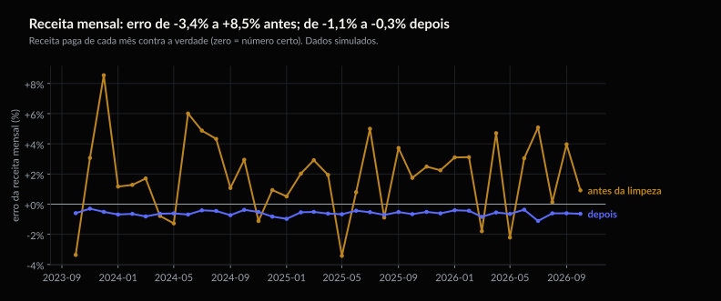
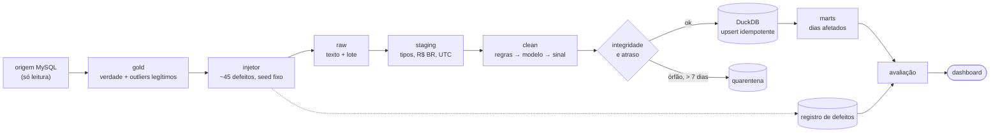
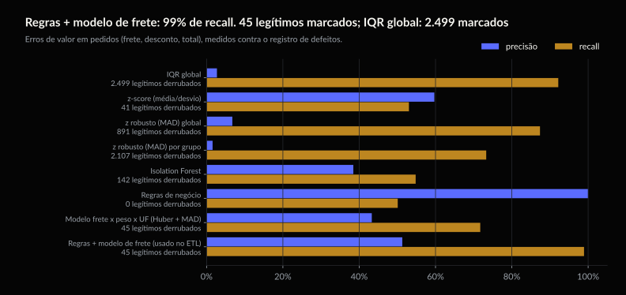
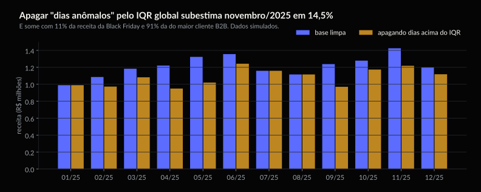

<p align="center">
  
  
  
  
</p>

# Qualidade de dados num ETL de e-commerce

**A base suja dizia que a loja faturou R$ 41,34 milhões; a verdade é R$ 40,56 milhões.** No total
o erro parece pequeno (+1,9%), porque erros para cima e para baixo se anulam. Mês a mês, a
receita errava de −3,4% a +8,5%, a taxa de cancelamento até 14%, e 81% de receita a mais caía
em "Sem região". Depois da limpeza, o erro mensal fica entre −1,1% e −0,3%, e cada real que
falta tem endereço: R$ 160 mil em quarentena, esperando uma decisão.

**E a limpeza "óbvia" faz pior que não limpar.** Apagar os dias acima da cerca do IQR global
subestima novembro de 2025 em 14,5% e some com 91% da receita do maior cliente B2B. Aplicado
aos pedidos, o IQR marca 34.697 para achar 942 erros.

**[Dashboard](https://arielabade.github.io/ecommerce-data-quality/dashboard/)** · dados
simulados: cada defeito foi injetado e registrado, por isso dá para medir o que a limpeza
acertou.

<p align="center"></p>

> **Decisão.** Regras de negócio e conciliação entre fontes corrigem; estatística robusta
> (mediana/MAD, modelo de frete por peso e UF, STL com calendário) só sinaliza ou imputa;
> ticket alto nunca é apagado; o que não fecha vai para quarentena com o valor em reais no
> relatório. Nunca IQR global para apagar.

<details>
<summary><b>O que há neste repositório</b></summary>

| | |
| --- | --- |
| **A pergunta** | Como achar e tratar os problemas de uma base de pedidos, e quanto cada decisão de limpeza muda os números de negócio? |
| **Os dados** | SIMULADOS. A base limpa da [Tecelã Tecidos](https://github.com/arielabade/dados-sinteticos-ecommerce-tecidos) (145 mil pedidos, 3 anos) recebeu ~45 tipos de defeito com semente fixa, cada um registrado com o valor original. |
| **O método** | ETL raw → staging → clean → marts, com contratos por camada, carga incremental idempotente e quarentena; cada técnica medida contra o registro de defeitos. |
| **O achado** | Regras + modelo robusto pegam 99% dos erros de valor e marcam 45 pedidos legítimos; o IQR global pega 92% e marca 2.499. |

```
src/dq/extract/    leitura do banco de origem (MySQL ou os CSVs que ele carrega)
src/dq/corrupt/    injetor de sujeira e registro de defeitos
src/dq/profile/    perfil de dados -> docs/DATA_SOURCE.md
src/dq/clean/      detecção e tratamento, um módulo por tipo de problema
src/dq/load/       integridade, quarentena, carga incremental idempotente, marts
src/dq/contracts/  contratos pandera por camada
src/dq/evaluate/   precisão/recall contra o registro e impacto no negócio
src/dq/report/     relatório de qualidade por execução, dashboard e figuras
```

</details>

---

## 01 — Contexto

A Tecelã Tecidos é uma loja online de tecidos (fictícia) que vende para quem costura por
hobby, costureiras, ateliês e confecções. O banco de origem tem pedidos, itens, fretes,
clientes, endereços e catálogo de outubro de 2023 a outubro de 2026: 145 mil pedidos e
R$ 40,6 milhões de receita paga. O perfil completo da origem está em
[`docs/DATA_SOURCE.md`](docs/DATA_SOURCE.md).

### Dados

**SIMULADOS, de propósito.** Em dados reais não se sabe qual valor estava errado; aqui está
escrito. A base de origem é normalizada (verdade), recebe três outliers **legítimos** e depois
os defeitos:

| Família | Exemplos | Linhas afetadas |
| --- | --- | ---: |
| Duplicatas | linha repetida, dia inteiro reenviado, checkout reenviado segundos depois | 1.706 |
| Não são vendas | pedidos de teste (R$ 1,00), rajadas de bot testando cartão | 274 |
| Valores | preço zero, negativo, vírgula perdida (x100), frete absurdo, frete trocado entre pedidos, desconto maior que o preço, quantidade negativa | 2.790 |
| Datas e fuso | ano trocado (2025 → 2052), WhatsApp gravando em UTC, entrega antes da compra | 1.189 |
| Integridade e atraso | item sem pedido, pedido sem cliente, pedido que chega 1 a 25 dias depois | 7.204 |
| Cadastro e texto | "ARACAJU", "aracajú", "Aracaju - SE", "Salavdor", "Sampa", CEP sem zero, categoria "Tecido tricolines", mesma pessoa em duas contas | 22.614 |
| Nulos | custo de frete ausente ao acaso, por transportadora e nos mais caros | 19.775 |
| **Legítimos** | Black Friday, um cliente B2B que compra R$ 4 mil a R$ 118 mil por pedido, uma chita que viraliza | 9.043 pedidos |

21,6% dos pedidos chegaram com algum defeito. O registro completo fica em
`data/defect_log/`, e **o ETL não consegue lê-lo**: um bloqueio em tempo de execução derruba o
processo se tentar, e há teste para isso.

---

## 02 — Problema

Três armadilhas que esta base reproduz:

1. **Erros que se anulam no total.** Frete gravado em centavos infla a receita; desconto
   gravado em centavos a derruba. O total do período erra 1,9%, mas o mês de dezembro de 2023
   erra 8,5%, e é o mês que alguém apresenta.
2. **Outlier não é erro.** A Black Friday, o cliente B2B e o produto viral são os números mais
   estranhos da base e os mais verdadeiros. A técnica que "limpa outliers" apaga justamente eles.
3. **Defeitos que nenhuma estatística vê.** Um frete normal no pedido errado, um dia inteiro
   reenviado que ainda fica abaixo do pico real, um pedido com o fuso de outro sistema.

---

## 03 — Estratégia

| Decisão | Por quê |
| --- | --- |
| **Gabarito escrito e bloqueado** | Cada técnica é medida contra o registro de defeitos; o ETL roda com o registro bloqueado por audit hook. |
| **Regras antes de estatística** | Identidades que valem em 100% da origem (total, frete do pedido = frete da transportadora, preço vs tabela) recuperam o valor **exato**. |
| **MAD, não desvio padrão** | O desvio é inflado pelos próprios erros; a mediana ignora até metade de lixo. |
| **Modelo de frete por peso e UF** | Sem a UF o resíduo típico é 25% e o frete trocado some; com a UF, 3%. |
| **STL + calendário comercial** | Pico explicado por data comercial é esperado; pico sem explicação vira alerta, não exclusão. |
| **Duplicata = janela + itens iguais** | Só a janela confunde bot e reposição de cliente com reenvio. |
| **Quarentena com valor em reais** | Item sem pedido muitas vezes é cabeçalho atrasado; volta sozinho quando o pai chega. |
| **Janela de 7 dias para atraso** | Até 7 dias o dia é reprocessado; depois, o mês fechado não muda sem decisão. |
| **Carga por chave + hash** | Rodar duas vezes não muda nada (o ETL confere a cada execução). |



Detalhes: [`docs/ARCHITECTURE.md`](docs/ARCHITECTURE.md) (camadas, tabelas, módulos),
[`docs/CATALOG.md`](docs/CATALOG.md) (cada defeito: como detecta, como trata, por quê),
[`docs/TECHNIQUES.md`](docs/TECHNIQUES.md) (guia das técnicas para negócio e com fórmulas),
[`docs/DECISIONS.md`](docs/DECISIONS.md) (decisões e alternativas descartadas).

---

## 04 — Resultado

### O que cada técnica pegou e o que errou (erros de frete, desconto e total)

| Técnica | Marcou | Precisão | Recall | Legítimos marcados | Receita real marcada |
| --- | ---: | ---: | ---: | ---: | ---: |
| IQR global | 34.697 | 2,7% | 92,2% | 2.499 | R$ 2,58 mi |
| z-score (média/desvio) | 908 | 59,7% | 53,0% | 41 | R$ 1,64 mi |
| z robusto (MAD) global | 13.223 | 6,8% | 87,4% | 891 | R$ 2,30 mi |
| z robusto (MAD) por grupo | 47.606 | 1,6% | 73,3% | 2.107 | R$ 2,57 mi |
| Isolation Forest | 1.456 | 38,5% | 54,8% | 142 | R$ 1,75 mi |
| Regras de negócio | 512 | 100,0% | 50,1% | 0 | R$ 0 |
| Modelo de frete (peso × UF) | 1.693 | 43,3% | 71,7% | 45 | R$ 63 mil |
| **Regras + modelo de frete (ETL)** | **1.971** | **51,3%** | **98,9%** | **45** | **R$ 63 mil** |

Nas outras famílias: regras de preço de item com **100% de precisão e 100% de recall**;
duplicatas exatas por hash 100%/99,8%; reenvio de checkout com janela + itens iguais
99,2%/100% (só a janela: 85%); bots por velocidade de IP 100%/100%; texto (cidade, UF, CEP,
e-mail) restaurado exatamente em 99,6% a 100% dos casos, sem alterar nenhum valor que estava
certo. Tabelas completas: [`reports/EVALUATION.md`](reports/EVALUATION.md).

<p align="center"></p>

### Impacto nas métricas de negócio

| Métrica (período todo) | Verdade | Antes | Depois |
| --- | ---: | ---: | ---: |
| Receita paga | R$ 40,56 mi | R$ 41,34 mi (+1,9%) | R$ 40,31 mi (−0,6%) |
| Pedidos | 145.898 | 147.654 | 145.073 |
| Ticket médio | R$ 298,36 | R$ 301,74 | R$ 298,25 |
| Cancelamento | 6,83% | 6,94% | 6,83% |
| Clientes que recompram | 56,5% | 57,1% | 56,5% |
| Clientes compradores | 48.756 | 49.343 | 48.544 |
| Categorias de produto | 23 | 47 | 25 |

| Pior mês ou região | Antes | Depois |
| --- | ---: | ---: |
| Receita mensal | +8,5% (dez/2023) | −1,1% |
| Cancelamento mensal | 13,7% de erro | 1,3% |
| Receita "Sem região" | +81% | −0,4% |
| Receita do Sudeste | −1,6% | −0,6% |

O que falta depois da limpeza (−0,6%) tem endereço: R$ 89 mil de pedidos que chegaram mais de
7 dias depois, R$ 71 mil de pedidos sem cliente (os dois em quarentena) e os pedidos cujo
cabeçalho nunca chegou (os itens, R$ 55 mil, também estão na quarentena).

### A decisão errada

<p align="center"></p>

| "Limpeza" com IQR global | Efeito |
| --- | --- |
| Apagar os dias acima da cerca da receita diária | novembro/2025 −14,5%; maio/2025 −22,9%; 91% da receita do cliente B2B e 11% da Black Friday somem |
| Apagar os pedidos acima da cerca do ticket | −38% da receita de um mês típico; 100% do cliente B2B e 30% da Black Friday |
| Limitar (winsorizar) a receita diária na cerca | novembro/2025 −5,1%; maio/2025 −12,8% |

### Recomendação e custo de cada erro

| Etapa | Técnica | Custo de errar aqui |
| --- | --- | --- |
| 1 | Regras de negócio e conciliação entre fontes (corrigem o valor exato) | baixo: a regra só age quando a identidade quebra |
| 2 | Modelo robusto de frete por peso e UF; mediana/MAD por grupo (imputam ou sinalizam) | R$ 2 mil de distorção passou; 45 pedidos reais com frete reestimado |
| 3 | STL + calendário comercial na série diária (só alerta) | um alerta a mais para alguém olhar |
| 4 | Hash e janela + itens iguais para duplicatas; velocidade para bots | nenhum pedido real removido; 7 marcados como reenvio eram bots |
| 5 | Quarentena com valor em reais, janela de 7 dias | R$ 160 mil fora da métrica até alguém decidir |
| ✗ | IQR global para apagar | R$ 2,58 mi de pedidos reais marcados, deixando passar quase a mesma distorção (R$ 3 mil) que a combinação recomendada (R$ 2 mil) |

---

## 05 — Limites e próximo passo

- **Dados simulados.** O que se transfere é o método e a forma de medir, não os números.
- **Os defeitos foram desenhados por quem escreveu a limpeza.** Isso é um viés otimista: na
  vida real aparecem defeitos que ninguém previu. Por isso a quarentena e as listas de revisão
  (`cidade_nao_reconhecida`, `categoria_nao_mapeada`) existem: para o que nenhuma regra conhece.
- **MNAR não tem solução com dados observados.** Quando somem justamente os fretes mais caros,
  o modelo erra R$ 10 por envio e sempre para baixo; só uma fonte externa (a fatura) resolve.
- **Frete trocado entre pedidos não tem valor exato recuperável**: o modelo estima, com erro
  médio de R$ 14 por pedido (antes: R$ 70).
- **Uma conta real chamada "Teste"** cai na regra de pedido de teste (1 pedido legítimo
  removido). Em produção, a lista de contas internas deveria vir do cadastro da equipe.
- **Próximo passo:** rodar a mesma avaliação com defeitos que o limpador não conhece (gerados
  por outra pessoa) e medir quanto vai para a quarentena em vez de passar.

---

## Como rodar

```bash
git clone https://github.com/arielabade/ecommerce-data-quality
cd ecommerce-data-quality
make install
cp .env.example .env            # credenciais do MySQL de origem (../ecommerce)

make data corrupt etl evaluate report test   # ponta a ponta (~6 min)
make small                                   # o mesmo pipeline na amostra versionada, sem MySQL (~1 min)
```

- **Origem:** o repositório [`../ecommerce`](https://github.com/arielabade/dados-sinteticos-ecommerce-tecidos)
  com o MySQL no ar (`make -C ../ecommerce dados mysql`). Ele é só lido.
  `DQ_SOURCE_KIND=csv make data` lê os CSVs que o banco carrega (mesmo conteúdo).
- **Configuração:** `config/default.yaml` (caminhos, incrementos), `config/corruption.yaml`
  (taxas e seed da sujeira), `config/cleaning.yaml` (limiares da limpeza),
  `config/mappings/` (tabelas de sinônimos versionadas).
- **Saídas:** `data/runs/<execução>/quality_report.md` (o que entrou, o que foi corrigido, o que
  ficou em quarentena), [`reports/quality_report.md`](reports/quality_report.md) (última
  execução), [`reports/EVALUATION.md`](reports/EVALUATION.md) e `docs/dashboard/`.
- **Testes (62):** cada regra com caso positivo e negativo, idempotência da carga, bloqueio do
  registro de defeitos, reprodutibilidade do injetor, contratos, catálogo e ponta a ponta no
  perfil pequeno. CI no GitHub Actions: ruff, testes e ponta a ponta.

---

<p align="center">
  <a href="https://github.com/arielabade/unit-economics-olist">← Preço por canal</a> &nbsp;·&nbsp;
  <a href="https://github.com/arielabade">Portfólio</a> &nbsp;·&nbsp;
  <a href="https://github.com/arielabade/marketing-mix-modeling">MMM validado contra a verdade →</a>
</p>
