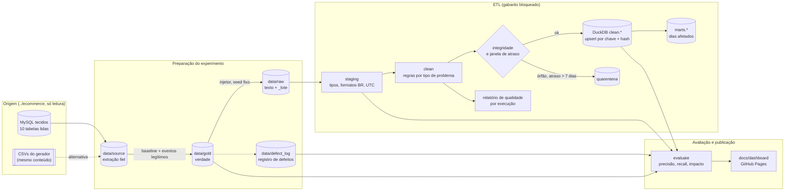
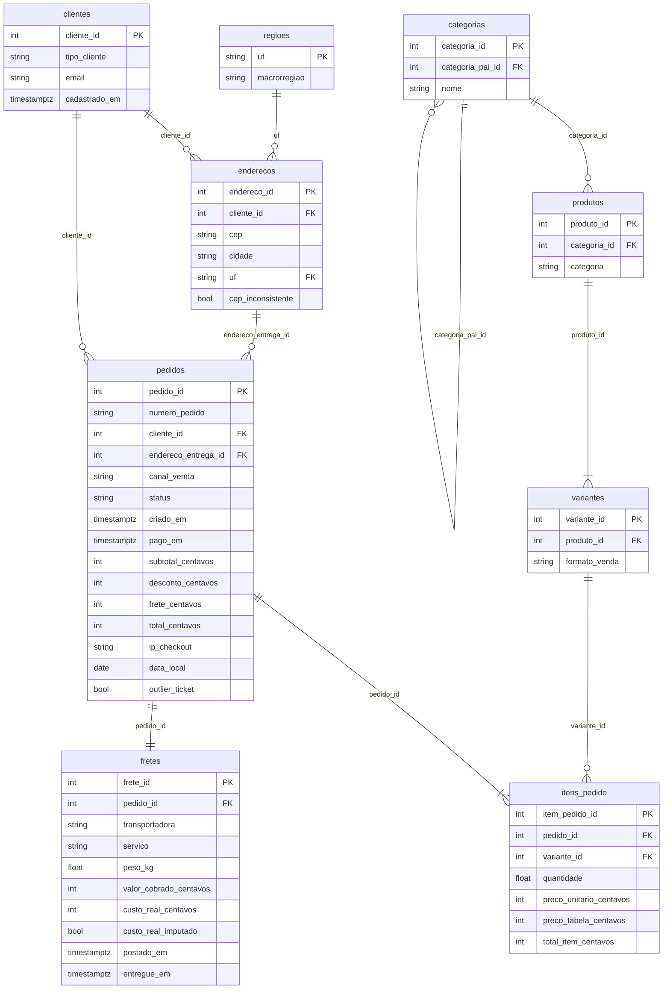

# Arquitetura

## Camadas e fluxo

O ETL (`dq.etl`) roda dentro de `dq.guard.truth_blocked`: qualquer tentativa de abrir
`data/defect_log` ou `data/gold` levanta `TruthAccessError`. Só `dq.evaluate` e `dq.report`
leem o gabarito, e o fazem depois que o ETL terminou.

### Camadas

| Camada | Onde | O que promete (contrato) |
| --- | --- | --- |
| raw | `data/raw/*.parquet` | colunas esperadas, tudo texto, `_lote` = dia em que o registro chegou |
| staging | `staging.*` no DuckDB | tipos certos; dinheiro em centavos; datas em UTC; nada removido nem corrigido |
| clean | `clean.*` no DuckDB | chave única, identidades contábeis, preço e quantidade > 0, datas em ordem, UF e CEP válidos, e-mail canônico |
| quarentena | `quarantine.registros` e `quarantine.historico` | o que ficou de fora, por quê e quanto vale; quando entrou e quando saiu |
| marts | `marts.*` | métricas de negócio não negativas, taxas entre 0 e 1 |
| meta | `meta.execucoes` | uma linha por execução: corte, inseridos, atualizados, removidos, idempotente |

### Carga incremental

`make etl` roda dois incrementos: lotes até 30/09/2026 e depois todos. Em cada execução:

1. lê o raw até o corte e roda staging + clean sobre tudo que chegou até ali (é barato nesta
   escala e garante que duplicatas e janelas de tempo atravessem lotes);
2. separa quarentena (órfãos, atraso acima de 7 dias, data irrecuperável);
3. faz upsert por chave natural e hash do conteúdo: linha nova entra, linha que mudou é
   substituída, linha igual não é tocada, linha que sumiu da entrada dentro do escopo de
   lotes sai;
4. recalcula nos marts só os dias tocados (e o mês deles e o seguinte, para a recompra);
5. reexecuta o último incremento e exige zero inserções, atualizações e remoções.

## Tabelas

Esquema canônico (gold e clean). Dinheiro em centavos inteiros, instantes em UTC.

Marts: `vendas_diarias` (dia × UF), `metricas_mensais` (mês × região), `receita_categoria_mensal`,
`clientes_resumo`, `alertas_diarios` (resíduo STL + calendário comercial).

## Módulos

| Módulo | Papel | Entra | Sai |
| --- | --- | --- | --- |
| `dq/settings.py` | YAML + ambiente; caminhos por perfil | `config/*.yaml`, `.env` | `Settings` |
| `dq/guard.py` | bloqueia o gabarito durante o ETL (audit hook) | caminhos proibidos | `TruthAccessError` |
| `dq/extract/source.py` | lê a origem (MySQL, CSV ou Parquet) | 10 tabelas | `data/source` |
| `dq/extract/snapshot.py` | amostra de 6% dos clientes para o CI | `data/source` | `data/sample` |
| `dq/extract/reference.py` | tabela de cidades/UF/faixa de CEP | gerador da origem | `config/mappings/cidades_referencia.csv` |
| `dq/profile/` | perfil de tabelas e `docs/DATA_SOURCE.md` | origem, raw | JSON + Markdown |
| `dq/corrupt/baseline.py` | origem → esquema canônico sem imperfeições nativas | `data/source` | tabelas base |
| `dq/corrupt/legit.py` | Black Friday, B2B, viral (outliers verdadeiros) | base | gold + registro `legitimo` |
| `dq/corrupt/defects.py` | injeta ~45 tipos de defeito | gold | tabelas sujas + registro |
| `dq/corrupt/formatting.py` | serializa para texto com formatos variados | tabelas sujas | `data/raw` |
| `dq/clean/staging.py` | tipos, moeda BR, três formatos de data, UTC | raw | staging |
| `dq/clean/text.py` | e-mail, cidade, UF, CEP, categoria | staging | texto canônico |
| `dq/clean/duplicates.py` | hash, janela + itens, contas por e-mail | staging | sem duplicatas |
| `dq/clean/suspicious.py` | pedidos de teste e de bot | pedidos | ids a remover |
| `dq/clean/dates.py` | data futura, fuso por segmento, ordem de entrega | pedidos, fretes | datas corrigidas |
| `dq/clean/business_rules.py` | preço, quantidade, desconto, totais | itens, pedidos | valores corrigidos |
| `dq/clean/freight.py` | conciliação de frete + modelo robusto peso × UF | pedidos, fretes, endereços | frete conciliado |
| `dq/clean/nulls.py` | diagnóstico do mecanismo e imputação | fretes | custo imputado |
| `dq/clean/outliers.py` | IQR, z-score, MAD, STL, Isolation Forest, winsorização | números | máscaras |
| `dq/clean/pipeline.py` | ordem das regras | raw | `CleanResult` |
| `dq/clean/audit.py` | registro de tratamento (o que a limpeza fez) | regras | DataFrame |
| `dq/load/integrity.py` | integridade referencial, janela de atraso | clean | tabelas + quarentena |
| `dq/load/warehouse.py` | DuckDB, upsert idempotente, histórico de quarentena | clean | `clean.*`, `quarantine.*` |
| `dq/load/marts.py` | métricas (mesmo SQL para gold, staging e clean) | esquema | `marts.*` |
| `dq/contracts/schemas.py` | contratos pandera por camada | tabelas | relatório / `ContractError` |
| `dq/etl.py` | orquestra incrementos e confere idempotência | raw | warehouse + relatório |
| `dq/report/quality.py` | relatório de qualidade por execução | execução | `data/runs/<id>/`, `reports/quality_report.md` |
| `dq/evaluate/` | precisão/recall, correções, imputação, impacto, decisão errada | warehouse + gabarito | `reports/` |
| `dq/report/dashboard.py`, `figures.py` | dashboard e figuras | `evaluation.json` | `docs/dashboard`, `assets/figures` |
